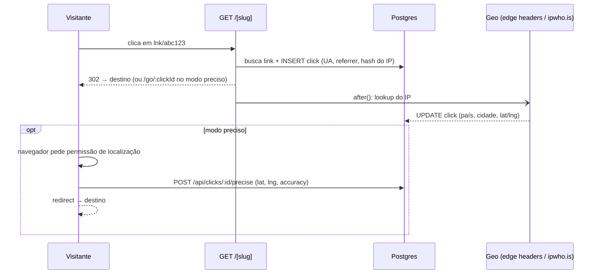

# LinkPulse — encurtador de links com analytics geográfico

Encurtador de URLs que registra **cada clique**: de onde veio (país, região, cidade e coordenadas), quando, em qual dispositivo/navegador/SO e de qual site a pessoa chegou. Mostra tudo num dashboard com mapa, série temporal e rankings.

O foco do projeto é **geolocalização com responsabilidade**: precisão de cidade por IP em todo clique, precisão de metros via GPS **somente com consentimento**, e nenhum IP bruto armazenado.


## Funcionalidades

- **Encurtar links** com slug aleatório (sem caracteres ambíguos) ou alias personalizado
- **Redirect rápido**: a geolocalização roda *depois* da resposta (`after()` do Next.js), então quem clica não espera a API de geo
- **Geolocalização por IP** com cadeia de provedores:
  1. Headers da edge (`x-vercel-ip-*` na Vercel, `cf-ip*` na Cloudflare): custo e latência zero
  2. Fallback para a API [ipwho.is](https://ipwho.is), com timeout curto
  3. Nunca lança erro: se tudo falhar, o clique é salvo sem geo
- **Modo localização precisa (opcional, por link)**: uma página intermediária pede permissão de GPS (Geolocation API). Quem recusa segue para o destino normalmente, e o dashboard mostra a taxa de aceite
- **Analytics**: cliques, visitantes únicos, cliques por dia (fuso `America/Sao_Paulo`), mapa (Leaflet), países, cidades, referrers, dispositivos, navegadores, sistemas e tabela dos últimos cliques
- **Filtro de bots**: previews de WhatsApp/Telegram/Slack, crawlers e `curl` são registrados, mas ficam fora das métricas
- **Privacidade**: o IP é pseudonimizado com `sha256(salt + ip)`. Isso basta para contar visitantes únicos sem guardar o dado pessoal (LGPD)

<p align="center"></p>

## Arquitetura



Decisões de design:

| Decisão | Por quê |
|---|---|
| `302` + `Cache-Control: no-store` | Um `301` seria cacheado pelo navegador e os próximos cliques não chegariam ao servidor |
| Insert síncrono + enriquecimento em `after()` | O id do clique existe antes do redirect (necessário no modo preciso), e a latência de geo fica fora do caminho crítico |
| Geo por IP e por GPS em colunas separadas | Não há corrida entre as duas escritas, e o dashboard sabe a origem e a precisão de cada ponto |
| Endpoint de GPS só aceita 1 envio, em até 5 min, e apenas em links com modo preciso | Evita que alguém injete coordenadas falsas em cliques antigos |
| Pontos do mapa agrupados numa grade de ~1 km | O mapa continua leve com milhares de cliques |

## Stack

Next.js 16 (App Router, Cache Components) · TypeScript · Prisma 6 · PostgreSQL · Tailwind CSS 4 · Recharts · Leaflet · Zod · Vitest

## Rodando localmente

Pré-requisitos: Node 20+ e PostgreSQL.

```bash
cp .env.example .env        # ajuste DATABASE_URL e IP_HASH_SALT
npm install
npm run db:migrate          # cria as tabelas
npm run db:seed             # opcional: 3 links com ~1.500 cliques de demonstração
npm run dev
```

Em `localhost` o IP é `127.0.0.1` e não tem geolocalização. Defina `GEO_DEV_IP` no `.env` com um IP público para simular cliques reais em desenvolvimento.

Testes:

```bash
npm test
```

## Deploy

Na **Vercel**, os headers `x-vercel-ip-*` já vêm em toda requisição, então a geo por IP funciona sem nenhuma API externa. Basta configurar `DATABASE_URL` (Neon, Supabase, Railway…) e `IP_HASH_SALT`, e rodar `npx prisma migrate deploy`.

## API

| Método | Rota | Descrição |
|---|---|---|
| `POST` | `/api/links` | `{ url, slug?, title?, preciseGeo? }` → cria link (`409` se o alias existir) |
| `GET` | `/api/links` | Lista links com total de cliques |
| `GET` | `/:slug` | Registra o clique e redireciona |
| `POST` | `/api/clicks/:id/precise` | `{ status: "granted", latitude, longitude, accuracy }` ou `{ status: "denied" \| "timeout" \| "unavailable" }` |

## Próximos passos

- Autenticação (cada usuário vê só os próprios links)
- Rate limiting na criação de links
- QR code por link
- Exportar cliques em CSV
