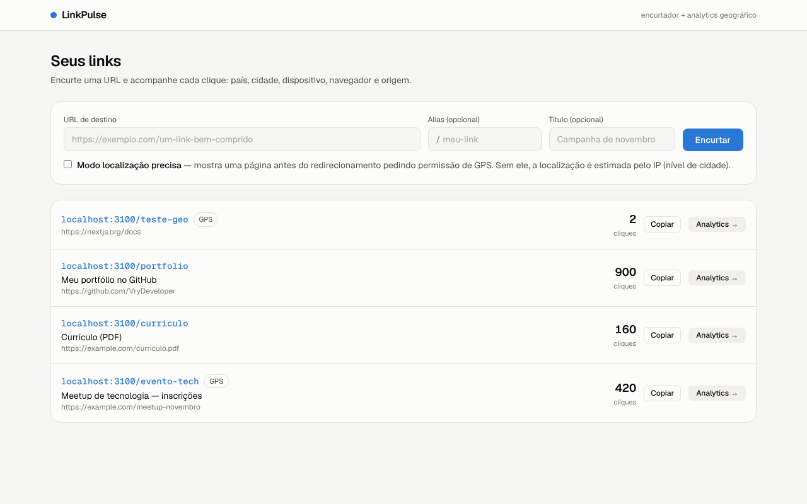
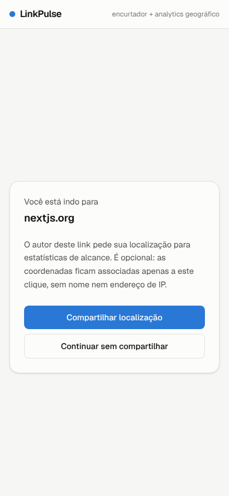
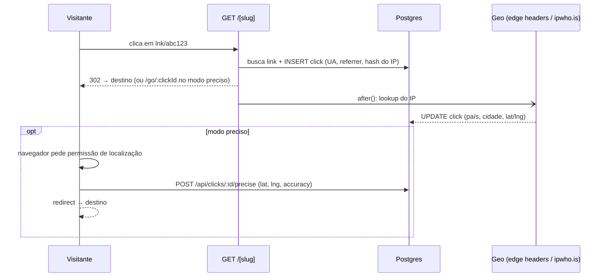

# LinkPulse — encurtador de links com analytics geográfico

Encurtador de URLs que registra **cada clique**: quando (com segundos e no fuso de quem clicou), de onde veio (IP, provedor de internet, país, estado, cidade, CEP e coordenadas), em qual dispositivo (tipo, fabricante, modelo, sistema e navegador com versões) e de qual site a pessoa chegou. Mostra tudo num dashboard com mapa, série temporal, rankings e o detalhe completo de cada clique.

O foco do projeto é **geolocalização**: precisão de cidade por IP em todo clique, e precisão de metros via GPS **com consentimento** de quem clica.



## Funcionalidades

- **Encurtar links** com slug aleatório (sem caracteres ambíguos) ou alias personalizado
- **Redirect rápido**: a geolocalização roda *depois* da resposta (`after()` do Next.js), então quem clica não espera a API de geo
- **Geolocalização por IP** com cadeia de provedores:
  1. Headers da edge (`x-vercel-ip-*` na Vercel, `cf-ip*` na Cloudflare): custo e latência zero
  2. Fallback para a API [ipwho.is](https://ipwho.is), com timeout curto
  3. Nunca lança erro: se tudo falhar, o clique é salvo sem geo
- **Modo localização precisa (opcional, por link)**: uma página intermediária pede permissão de GPS (Geolocation API). Quem recusa segue para o destino normalmente, e o dashboard mostra a taxa de aceite
- **Analytics**: cliques, visitantes únicos, cliques por dia (fuso `America/Sao_Paulo`), mapa (Leaflet), países, cidades, referrers, dispositivos, navegadores e sistemas
- **Detalhe de cada clique**: data e hora (Brasília, UTC e hora local de quem clicou), IP, provedor de internet e ASN, país, estado, cidade, CEP, fuso, coordenadas (com link para o mapa), GPS, tipo/fabricante/modelo do aparelho, sistema e navegador com versão, idioma, referrer completo e user agent
- **Filtro de bots e pré-carregamento**: previews de WhatsApp/Telegram/Slack, crawlers e `curl` são registrados, mas ficam fora das métricas. Requisições de *prefetch* do navegador nem contam como clique
- **Visitantes únicos** contados por `sha256(salt + ip)`

### Precisão da geolocalização por IP

A localização por IP indica onde fica o **ponto de saída da rede do provedor**, não o aparelho. Em banda larga costuma acertar a cidade. Em **4G/5G** é comum aparecer a cidade onde a operadora concentra o tráfego (às vezes a capital ou outro estado). Para precisão real, use o modo GPS.

### Dados pessoais (LGPD)

IP e localização são dados pessoais. Ao usar em produção, informe na sua política de privacidade que os cliques são registrados e defina um prazo de retenção.

<p align="center"></p>

## Arquitetura



Decisões de design:

| Decisão | Por quê |
|---|---|
| `302` + `Cache-Control: no-store` | Um `301` seria cacheado pelo navegador e os próximos cliques não chegariam ao servidor |
| Insert síncrono + enriquecimento em `after()` | O id do clique existe antes do redirect (necessário no modo preciso), e a latência de geo fica fora do caminho crítico |
| Geo por IP e por GPS em colunas separadas | Não há corrida entre as duas escritas, e o dashboard sabe a origem e a precisão de cada ponto |
| Endpoint de GPS só aceita 1 envio, em até 5 min, e apenas em links com modo preciso | Evita que alguém injete coordenadas falsas em cliques antigos |
| Pontos do mapa agrupados numa grade de ~1 km | O mapa continua leve com milhares de cliques |

## Stack

Next.js 16 (App Router, Cache Components) · TypeScript · Prisma 6 · PostgreSQL · Tailwind CSS 4 · Recharts · Leaflet · Zod · Vitest

## Rodando localmente

Pré-requisito: **Node 20.12+**. Você não precisa instalar Postgres nem Docker, nem criar conta em lugar nenhum.

```bash
npm install
npm run setup   # cria o .env, sobe o Postgres local, aplica as migrations e insere dados de demo
npm run dev     # http://localhost:3000
```

O banco local é o **Postgres embutido do Prisma** (`prisma dev`, baseado em PGlite). É um Postgres de verdade rodando em segundo plano, sem instalação. O `npm run dev` sobe esse banco automaticamente, e o `npm run setup` pode ser rodado de novo sem apagar seus dados.

| Comando | O que faz |
|---|---|
| `npm run setup` | Configuração inicial completa (idempotente) |
| `npm run dev` | Sobe o banco local (se necessário) e o app |
| `npm run db:stop` | Para o banco local |
| `npm run db:seed` | **Recria** os dados de demonstração (apaga os existentes) |
| `npm run db:studio` | Abre o Prisma Studio para navegar nas tabelas |
| `npm test` | Testes unitários (Vitest) |

Para usar outro Postgres (Neon, Supabase, Docker…), troque o `DATABASE_URL` no `.env`. Os scripts detectam a troca e deixam de subir o banco local.

Em `localhost` o clique chega como `127.0.0.1`, que não tem geolocalização. Por isso, em desenvolvimento, o app descobre sozinho o **IP público da sua máquina** e registra a sua localização real. Para simular um clique de outro lugar, preencha `GEO_DEV_IP` no `.env`.

## Deploy

Na **Vercel**, os headers `x-vercel-ip-*` já vêm em toda requisição, então a geo por IP funciona sem nenhuma API externa. Basta configurar `DATABASE_URL` com um Postgres na nuvem (Neon, Supabase, Railway…) e `IP_HASH_SALT`, e rodar `npx prisma migrate deploy`.

## API

| Método | Rota | Descrição |
|---|---|---|
| `POST` | `/api/links` | `{ url, slug?, title?, preciseGeo? }` → cria link (`409` se o alias existir) |
| `GET` | `/api/links` | Lista links com total de cliques |
| `GET` | `/:slug` | Registra o clique e redireciona |
| `POST` | `/api/clicks/:id/precise` | `{ status: "granted", latitude, longitude, accuracy }` ou `{ status: "denied" \| "timeout" \| "unavailable" }` |

## Próximos passos

- Autenticação (cada usuário vê só os próprios links)
- Rate limiting na criação de links
- QR code por link
- Exportar cliques em CSV
